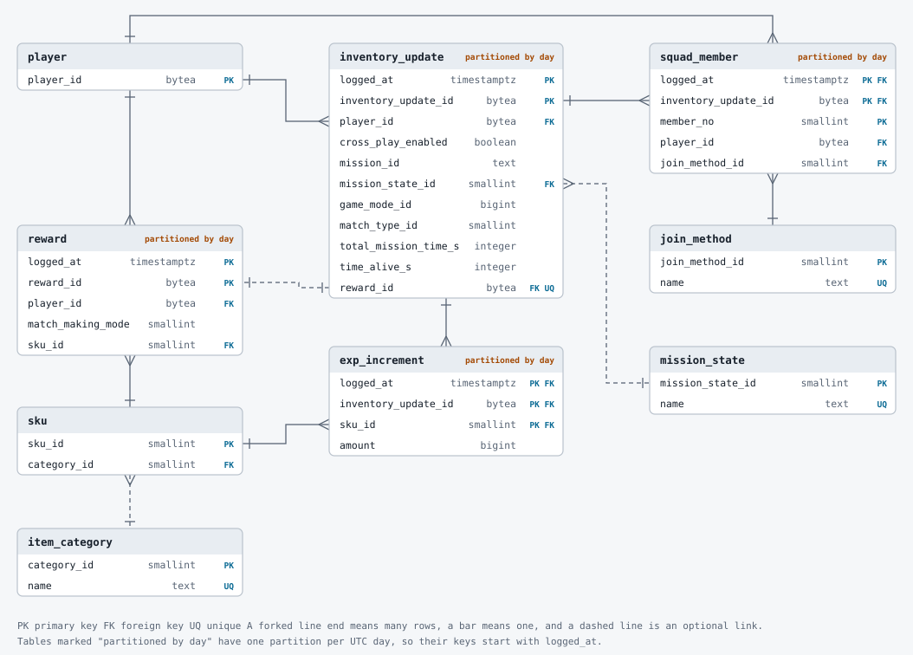

# Part B: MongoDB to PostgreSQL

A Python script that reads the Warframe player logs from MongoDB, reshapes them into nine PostgreSQL tables, and loads them.

## Files

| File | Contents |
|---|---|
| `er-diagram.svg` | Task 1: the ER diagram. |
| `etl.py` | Task 2a: the script that reads MongoDB, transforms, and loads PostgreSQL. |
| `schema.sql` | Task 2b: the DDL. `etl.py` runs it at the start of every load. |
| `validate.py` | Compares MongoDB with PostgreSQL after a load. |
| `tests/` | 62 checks, using Python's built-in `unittest`. |
| `ANSWERS.md` | Answers to the questions, and some notes  |
| `requirements.txt` | The two database drivers, `pymongo` and `psycopg`. |

## Run It

Requires Docker and Python 3.10 or later. Run these from this folder:

```
docker compose -f "../ExternalAssets/SeniorDataOpsAndServicesProgrammerTest/docker-compose.yml" up -d
pip install -r requirements.txt
python etl.py
python validate.py
python -m unittest
```

`python etl.py` creates the `game_log` schema if it is missing, loads every document, and prints:

```
Read 15,286 documents in 4 batches.
  player                   9,002 rows inserted
  reward                   5,286 rows inserted
  inventory_update        10,000 rows inserted
  exp_increment           32,494 rows inserted
  squad_member             7,946 rows inserted
Rejected 0 documents.
```

`python validate.py` measures both databases and prints one line per figure. It ends with `All 22 checks match.`

| Option | Effect |
|---|---|
| `--batch-size N` | Documents per transaction. The default is 5,000. |
| `--from-start` | Read every document again. Rows that are already loaded are skipped. |
| `--mongo-uri`, `--postgres-dsn` | Connect somewhere other than the supplied containers. |

To start again from nothing, drop the schema:

```
docker exec postgres-container psql -U postgres -c "DROP SCHEMA game_log CASCADE"
```

## ER Diagram



| Table | One Row Per | Filled From |
|---|---|---|
| `inventory_update` | Inventory document | The document's own fields. |
| `exp_increment` | Entry in `increment_exp` | A key such as `warframe:127:count` gives the SKU, and its value is the amount. |
| `squad_member` | Entry in `multiplayer_info` | The array position, the player, and the join method. |
| `reward` | Rewards document | The document's own fields. |
| `player` | Player id | Every id seen, as a document's owner or as a squad member. |
| `sku` | SKU | The SKU numbers in `increment_exp` keys and in rewards. |
| `item_category` | Category | The first part of an `increment_exp` key. |
| `mission_state`, `join_method` | Value | The distinct values of those two fields. |

`schema.sql` also creates `load_progress`, which holds the last document loaded. It is the script's own state, so it is not in the diagram.

## What the Script Does

1. Runs `schema.sql`, which changes nothing if the tables already exist.
2. Reads the next 5,000 documents in `_id` order, starting after the last document an earlier run loaded.
3. Turns each document into rows. A document that fails a check is left out, and its id and the reason are written to `rejected_documents.log`.
4. Creates the partitions for each UTC day in the batch, if they are missing.
5. Copies the rows into temporary tables, then inserts the ones PostgreSQL does not have yet. Parent tables go first.
6. Saves the last `_id` in the same transaction, so a batch and its progress mark are committed together.
7. Repeats until MongoDB has no more documents, then prints the totals.

Running it again reads nothing. Running it with `--from-start` reads everything and inserts nothing.

## Code Style

The Python follows PEP 8, formatted by hand. As in Part A, names are written out in full, each statement has its own line, and a call's result is stored in a named local before it is passed on.

## What was Verified

- The load of all 15,286 documents takes about 4 seconds, and no document is rejected
- A second run reads 0 documents, and a run with `--from-start` reads 15,286 documents and inserts 0 rows
- `validate.py` reports that all 22 figures match between MongoDB and PostgreSQL
- 62 checks pass
- `schema.sql` was run twice in a row on an empty database without error

Tested with Python 3.12.6, PostgreSQL 14.25, and MongoDB 9.0.8 only. Nothing was tested at the 25 million documents a day that question 3 describes.
